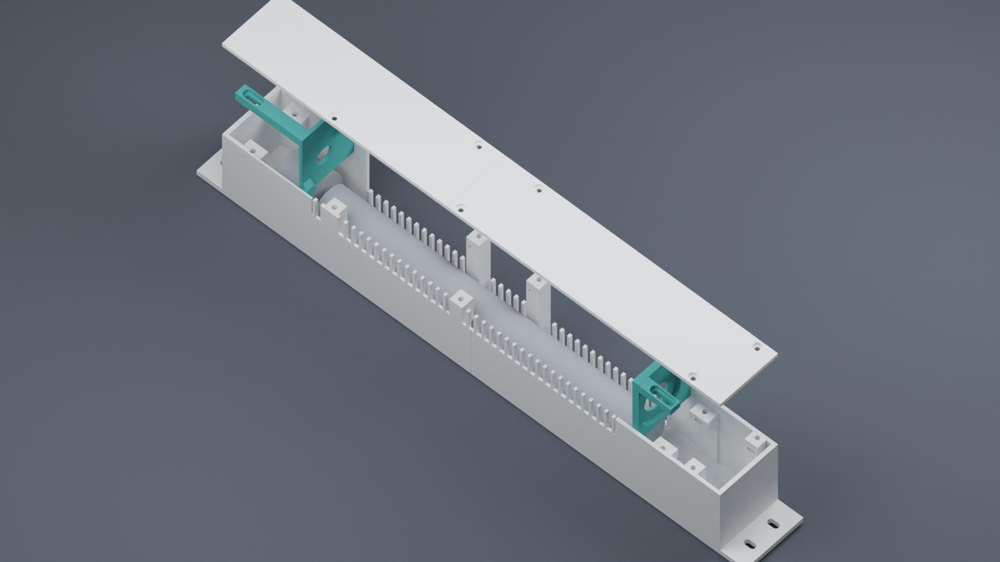
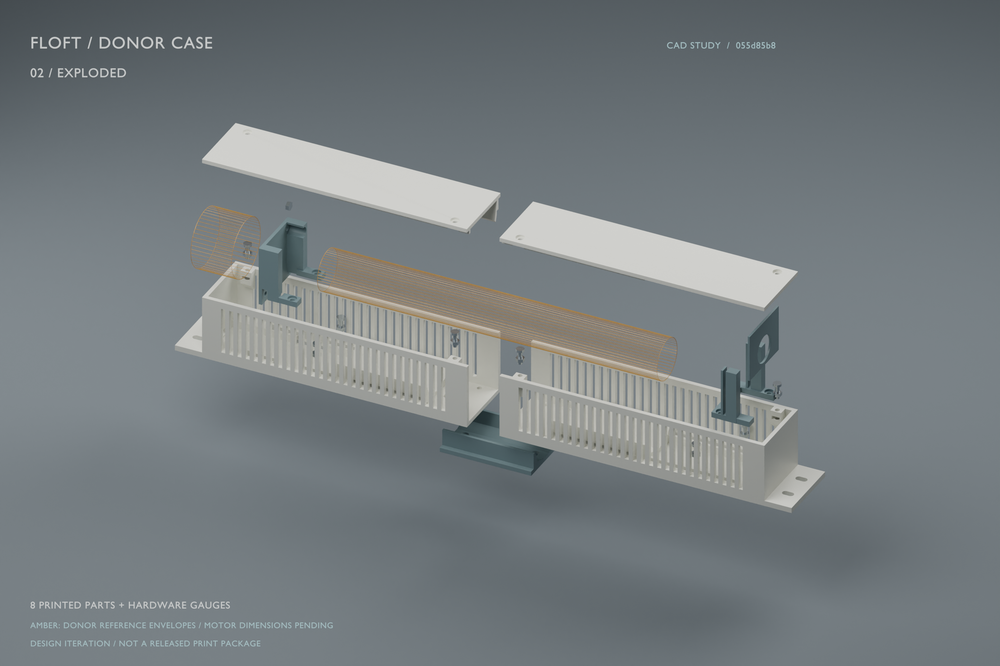

# Crossflow fan

Exploded-view CAD renders of a crossflow-fan casing prototype.

## Candidate 10 — October 27, 2026

Latest casing iteration, showing the removable roof and end carriers.

## Earlier prototype — October 18, 2026

Earlier casing iteration, with donor rotor and motor reference envelopes shown in amber.

These images depict development prototypes. This repository contains renders only.
